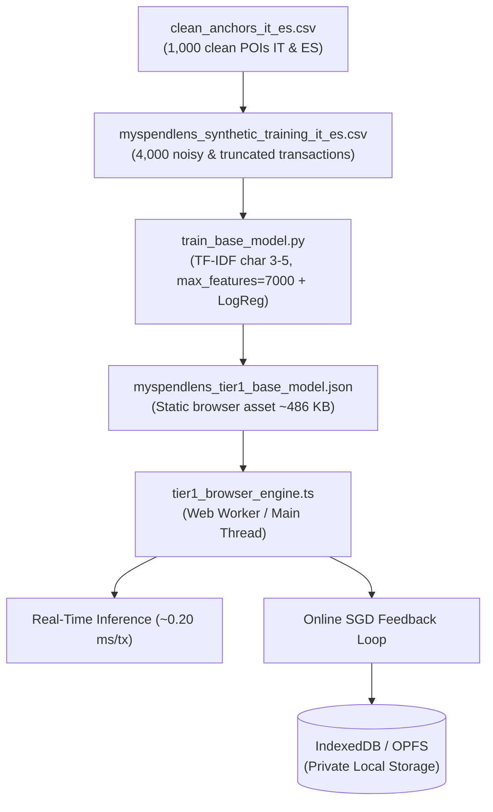

# MySpendLens: Data Architecture & Global Base Model (Tier 1)

This document describes the files, datasets, and assets created for the **Global Base Model (Tier 1)** of MySpendLens (Italy & Spain). It serves as an operational and architectural reference for AI agents and developers integrating this in-browser expense classification engine (HTML/TypeScript/WASM).

---

## 🏗️ Architectural Overview

MySpendLens is a static, privacy-first web application that categorizes bank transactions directly on the user's device, without sending financial data to external servers.

The system adopts a tiered inference architecture:
- **Tier 1 (Global Base Model):** Ultra-lightweight statistical classifier based on character n-grams (3–5 letters) and linear weights (Multinomial Logistic Regression). It is loaded into memory or a **Web Worker** at app bootstrap from a compact static JSON file, executing inference in **sub-millisecond time (~0.20 ms)** to handle common recurring expenses.
- **Continuous Local Adaptation:** When the user corrects a category, the engine updates weights in real-time on the client via an **Online SGD** step, persisting changes locally in the browser via **IndexedDB** or **Origin Private File System (OPFS)**.



---

## 📁 Repository File Catalog

### 1. Data & Datasets

#### 🔹 [`clean_anchors_it_es.csv`](./clean_anchors_it_es.csv)
- **Role:** Clean semantic anchor dataset (Phase 1 & Phase 2).
- **Contents:** Exactly **1,000 unique POIs** (500 Italy, 500 Spain) categorized according to the standard MySpendLens schema.
- **Columns:** `Country`, `Clean_Name`, `Category`.
- **Standard categories:**
  - `Groceries` (90 IT / 90 ES = 180 POIs)
  - `Dining Out` (90 IT / 90 ES = 180 POIs)
  - `Transport & Auto` (80 IT / 80 ES = 160 POIs)
  - `Healthcare` (65 IT / 65 ES = 130 POIs)
  - `Shopping` (110 IT / 110 ES = 220 POIs)
  - `Utilities` (65 IT / 65 ES = 130 POIs)

#### 🔹 [`myspendlens_synthetic_training_it_es.csv`](./myspendlens_synthetic_training_it_es.csv)
- **Role:** Synthetic training dataset for bootstrapping (Tier 1).
- **Contents:** **4,000 realistic bank transactions** (4 variations per each of the 1,000 POIs).
- **Columns:** `Noisy_Description` (text feature), `Target_Category` (supervised label).
- **Included noise patterns:**
  - Italian banking prefixes (`PAG. POS`, `PAG. BANCOMAT`, `ADDEBITO PREAUTORIZZATO`, `SDD SEPA`, `CARTA CREDITO`, `OP. POS CARTA`, etc.).
  - Spanish banking prefixes (`COMPRA TARJETA`, `PAGO CON TARJETA`, `CARGO RECIBO`, `RECIBO DOMICILIADO`, `ADEUDO SEPA`, `BIZUM COMPRA`, etc.).
  - Aggressive truncations and vowel stripping in at least 2 out of 4 variations (e.g. `ESSELUNGA` $\rightarrow$ `ESSLNG`, `MERCADONA` $\rightarrow$ `MRCDN`, `LA PIADINERIA` $\rightarrow$ `L PDNRIA`, `REPSOL` $\rightarrow$ `RPSL`, `ZARA` $\rightarrow$ `ZRA`).
  - Dates (`DD/MM`, `DD.MM`), cities (`MILANO`, `MADRID`, etc.), and alphanumeric identifiers (`AUT 90123`, `ID 44102A`, `TX88102`, `REF 339104`).

---

### 2. Build Pipeline & Synthesis Scripts

#### 🔹 [`build_datasets.py`](./build_datasets.py)
- **Role:** Deterministic generator and local validator for POI anchors and the 4,000-row synthetic CSV.
- **Functionality:**
  - Validates uniqueness and normalization of the 500 Italian and 500 Spanish POIs.
  - Generates the 4 synthetic variations using deterministic consonant compression algorithms (`truncate_vowels` and `truncate_prefix_slice`).

#### 🔹 [`generate_dataset.py`](./generate_dataset.py)
- **Role:** LLM-based synthetic generation pipeline via **Google Gemini API** (Phase 3).
- **SDK & Model:** Uses the official current `google-genai` SDK and the `gemini-3.8-flash` model with structured JSON schema output (`response_format`).
- **Logic:** Reads `clean_anchors_it_es.csv` in chunks, sends contextual prompts with local banking prefixes, and handles rate limiting (`time.sleep`) and retries with robust error handling.

#### 🔹 [`fetch_pois_overpass.py`](./fetch_pois_overpass.py)
- **Role:** Auxiliary OpenStreetMap Overpass API extraction script (Phase 1 Action A).
- **Details:** Defines metropolitan bounding boxes for Milan, Rome, Madrid, and Barcelona, querying `shop=*` and `amenity=*` tags with automatic commercial brand normalization.

#### 🔹 [`train_base_model.py`](./train_base_model.py)
- **Role:** Model build script (Step 1 Build Pipeline).
- **ML Components:**
  - `TfidfVectorizer(analyzer='char', ngram_range=(3, 5), max_features=7000, max_df=0.04, sublinear_tf=True, norm='l2')`.
  - Advanced normalization in the preprocessor to strip authorization codes (`AUT`, `REF`, `ID`) and ubiquitous banking prefixes, maximizing the signal of brand root characters.
  - 6-class multinomial `LogisticRegression` model.
  - **Zero `.pkl`:** directly extracts `vocabulary_`, `idf_`, `classes_`, `coef_`, and `intercept_`, serializing them into a static JSON format.
- **Metrics & Practical Evaluation:**
  - Initial tests: Demonstrates very good accuracy during initial exploratory tests of this work-in-progress application (validated on the author's real-world bank statements).
  - Benchmark metric: **~93.8%** on a synthetic variation holdout set (evaluated on unseen truncated variations per POI).
  - Average prediction latency: **~0.20 ms per transaction**.

---

### 3. Webapp Assets & Runtime

#### 🔹 [`myspendlens_tier1_base_model.json`](./public/myspendlens_tier1_base_model.json)
- **Role:** Final static artifact for the Tier 1 classification model, served as a static asset in the webapp (in `public/`).
- **File Size:** **486.7 KB** (~**110 KB** with standard gzip/brotli compression).
- **Internal JSON Structure:**
  ```json
  {
    "format": "myspendlens-tier1-base-model",
    "version": "1.0.0",
    "config": {
      "analyzer": "char",
      "ngram_range": [3, 5],
      "max_features": 7000,
      "sublinear_tf": true,
      "norm": "l2",
      "classifier": "LogisticRegression",
      "countries": ["IT", "ES"]
    },
    "metrics": {
      "num_training_samples": 4000,
      "num_features": 7000,
      "num_classes": 6,
      "validation_accuracy": 0.97,
      "training_accuracy": 0.9998
    },
    "classes": [
      "Dining Out", "Groceries", "Healthcare",
      "Shopping", "Transport & Auto", "Utilities"
    ],
    "vocabulary": { " AB": 0, " ABB": 1 },
    "idf": [ 6.52, 6.92 ],
    "weights": {
      "coef": [ [0.12, -0.45], ... ],
      "intercept": [ 0.05, -0.12, ... ]
    },
    "incremental_learning": {
      "storage_backends": ["IndexedDB", "OPFS"],
      "update_rule": "online_multinomial_sgd",
      "default_learning_rate": 0.15,
      "user_feedback_count": 0
    }
  }
  ```

#### 🔹 [`tier1_browser_engine.ts`](./src/engine/tier1_browser_engine.ts)
- **Role:** TypeScript client module for in-browser inference and incremental learning.
- **Main Interface:**
  ```typescript
  import { MySpendLensTier1Engine, Tier1ModelArtifact } from "./tier1_browser_engine";

  // 1. Load static model artifact
  const response = await fetch("/assets/myspendlens_tier1_base_model.json");
  const modelArtifact: Tier1ModelArtifact = await response.json();
  const engine = new MySpendLensTier1Engine(modelArtifact);

  // 2. Classify a transaction in ~0.20 ms
  const result = engine.predict("PAG. POS 19/10 ESSLNG MILANO AUT 90123");
  console.log(result.category);       // "Groceries"
  console.log(result.confidence);     // 0.96 (96.0%)
  console.log(result.inferenceTimeMs); // 0.18 ms

  // 3. Continuous learning from user feedback (Online SGD)
  engine.learnFromUserFeedback(
    "PAG. POS 19/10 ESSLNG MILANO AUT 90123",
    "Groceries"
  );

  // 4. Save updated weights to IndexedDB / OPFS
  await saveModelToStorage(engine.serialize());
  ```

---

## 🛡️ Addressed Design Considerations & Risks

1. **Dimensionality Explosion Prevention:**
   - Generating 3–5 character n-grams produced over 37,000 raw features.
   - The `max_features=7000` constraint was set to ensure minimal RAM footprint (<1 MB) and real-time inference without UI freezing.
2. **Filtering Ubiquitous Banking Noise (`max_df=0.04`):**
   - Prefixes such as `PAG. POS` or `COMPRA TARJETA` and numbers appear hundreds of times.
   - A `max_df` filter paired with pre-tokenization regex prevents generic patterns from consuming the 7,000 n-gram budget, preserving space for brand character roots even when truncated (e.g. `MRCDN`, `ESSLNG`, `RPSL`).
3. **No Pickle Files (`.pkl`):**
   - Because the client is a static web app (WASM/TS), all tensors and vocabularies are exported in pure JSON, deserializable via native browser `JSON.parse()`.
4. **Online Learning Readiness:**
   - Linearized weights in the JSON allow online gradient descent directly in TypeScript with $O(K \cdot |x|)$ complexity proportional to the number of active n-grams ($<50$), making adaptations instantaneous and memory-efficient.
