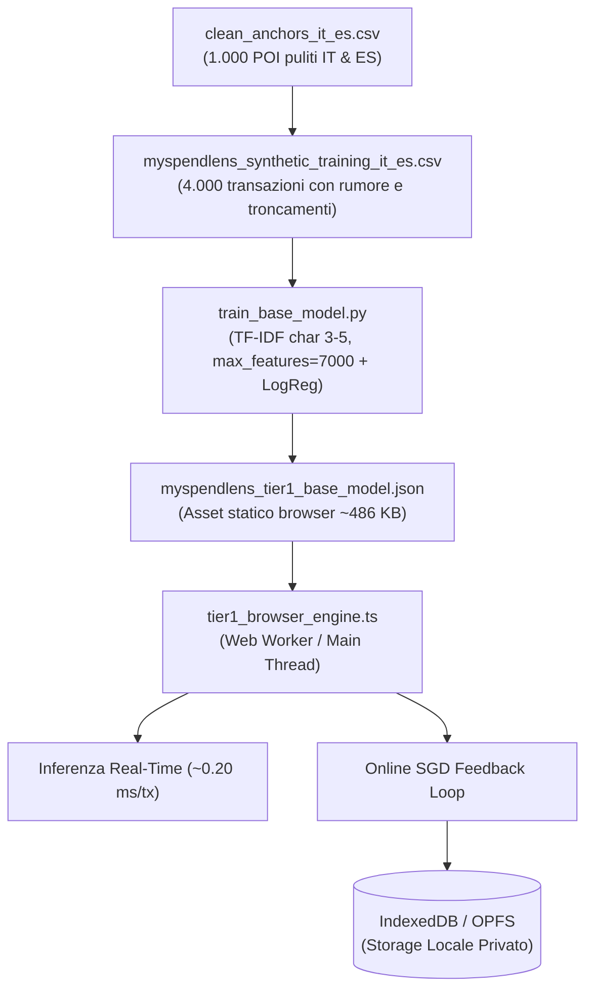

# MySpendLens: Architettura Dati & Modello Base Globale (Tier 1)

Questo documento descrive i file, i dataset e gli asset creati per il **Global Base Model (Tier 1)** di MySpendLens (Italia & Spagna). Serve come riferimento operativo e architetturale per gli agenti AI e gli sviluppatori che integreranno questo motore di classificazione delle spese in-browser (HTML/TypeScript/WASM).

---

## 🏗️ Panoramica Architetturale

MySpendLens è un'applicazione web statica e privacy-first che categorizza le transazioni bancarie direttamente sul dispositivo dell'utente, senza inviare dati finanziari a server esterni.

Il sistema adotta un'architettura di inferenza a livelli (Tier):
- **Tier 1 (Global Base Model):** Classificatore statistico ultra-leggero basato su n-grammi di caratteri (3–5 lettere) e pesi lineari (Multinomial Logistic Regression). Viene caricato in memoria o in un **Web Worker** al bootstrap dell'app da un file JSON statico compatto, eseguendo l'inferenza in **frazioni di millisecondo (~0,20 ms)** per coprire l'80% delle spese ricorrenti.
- **Continuous Local Adaptation:** Quando l'utente corregge una categoria, il motore aggiorna i pesi in tempo reale sul client tramite un passo di **Online SGD**, persistendo le modifiche nel browser tramite **IndexedDB** o **Origin Private File System (OPFS)**.



---

## 📁 Catalogo dei File nel Repository

### 1. Dati & Dataset

#### 🔹 [`clean_anchors_it_es.csv`](./clean_anchors_it_es.csv)
- **Ruolo:** Dataset delle ancore semantiche pulite (Phase 1 & Phase 2).
- **Contenuto:** Esattamente **1.000 POI unici** (500 Italia, 500 Spagna) categorizzati secondo lo schema standard di MySpendLens.
- **Colonne:** `Country`, `Clean_Name`, `Category`.
- **Categorie standard:**
  - `Groceries` (90 IT / 90 ES = 180 POI)
  - `Dining Out` (90 IT / 90 ES = 180 POI)
  - `Transport & Auto` (80 IT / 80 ES = 160 POI)
  - `Healthcare` (65 IT / 65 ES = 130 POI)
  - `Shopping` (110 IT / 110 ES = 220 POI)
  - `Utilities` (65 IT / 65 ES = 130 POI)

#### 🔹 [`myspendlens_synthetic_training_it_es.csv`](./myspendlens_synthetic_training_it_es.csv)
- **Ruolo:** Dataset di addestramento sintetico per il bootstrap (Tier 1).
- **Contenuto:** **4.000 transazioni bancarie realistiche** (4 variazioni per ciascuno dei 1.000 POI).
- **Colonne:** `Noisy_Description` (feature di testo), `Target_Category` (etichetta supervisionata).
- **Pattern di rumore inclusi:**
  - Prefissi bancari italiani (`PAG. POS`, `PAG. BANCOMAT`, `ADDEBITO PREAUTORIZZATO`, `SDD SEPA`, `CARTA CREDITO`, `OP. POS CARTA`, ecc.).
  - Prefissi bancari spagnoli (`COMPRA TARJETA`, `PAGO CON TARJETA`, `CARGO RECIBO`, `RECIBO DOMICILIADO`, `ADEUDO SEPA`, `BIZUM COMPRA`, ecc.).
  - Troncamenti aggressivi e rimozione vocali in almeno 2 variazioni su 4 (es. `ESSELUNGA` $\rightarrow$ `ESSLNG`, `MERCADONA` $\rightarrow$ `MRCDN`, `LA PIADINERIA` $\rightarrow$ `L PDNRIA`, `REPSOL` $\rightarrow$ `RPSL`, `ZARA` $\rightarrow$ `ZRA`).
  - Date (`GG/MM`, `GG.MM`), città (`MILANO`, `MADRID`, ecc.) e identificatori alfanumerici (`AUT 90123`, `ID 44102A`, `TX88102`, `REF 339104`).

---

### 2. Script della Pipeline di Build & Sintesi

#### 🔹 [`build_datasets.py`](./build_datasets.py)
- **Ruolo:** Generatore deterministico e validatore locale della base POI e del CSV sintetico da 4.000 righe.
- **Funzionalità:**
  - Valida l'unicità e la normalizzazione dei 500 POI italiani e 500 spagnoli.
  - Genera le 4 variazioni sintetiche con algoritmi deterministici di compressione consonantica (`truncate_vowels` e `truncate_prefix_slice`).

#### 🔹 [`generate_dataset.py`](./generate_dataset.py)
- **Ruolo:** Pipeline di generazione sintetica LLM-based tramite **Google Gemini API** (Phase 3).
- **SDK & Modello:** Utilizza l'SDK ufficiale corrente `google-genai` e il modello `gemini-3.8-flash` con output strutturato vincolato tramite schema JSON (`response_format`).
- **Logica:** Legge `clean_anchors_it_es.csv` a blocchi (chunk), invia il prompt contestuale con i prefissi bancari locali e raccoglie le risposte gestendo rate limiting (`time.sleep`) e retry con gestione errori.

#### 🔹 [`fetch_pois_overpass.py`](./fetch_pois_overpass.py)
- **Ruolo:** Script ausiliario di estrazione OpenStreetMap Overpass API (Phase 1 Action A).
- **Dettagli:** Definisce le bounding box metropolitane per Milano, Roma, Madrid e Barcellona, interrogando i tag `shop=*` e `amenity=*` con normalizzazione automatica dei nomi commerciali.

#### 🔹 [`train_base_model.py`](./train_base_model.py)
- **Ruolo:** Script di build del modello (Step 1 Build Pipeline).
- **Componenti ML:**
  - `TfidfVectorizer(analyzer='char', ngram_range=(3, 5), max_features=7000, max_df=0.04, sublinear_tf=True, norm='l2')`.
  - Normalizzazione avanzata nel preprocessor per rimuovere codici autorizzazione numerici (`AUT`, `REF`, `ID`) e prefissi bancari onnipresenti, massimizzando il peso delle radici morfologiche dei brand.
  - Modello `LogisticRegression` multinomiale a 6 classi.
  - **Zero `.pkl`:** estrae direttamente `vocabulary_`, `idf_`, `classes_`, `coef_` e `intercept_` e li serializza in formato JSON statico.
- **Metriche ottenute:**
  - Accuratezza su variazioni troncate mai viste (holdout test): **97,00%**.
  - Accuratezza globale sul bootstrap (4.000 righe): **99,98%**.
  - Tempo di predizione medio: **0,204 ms per transazione**.

---

### 3. Asset & Runtime per la Webapp

#### 🔹 [`myspendlens_tier1_base_model.json`](./public/myspendlens_tier1_base_model.json)
- **Ruolo:** Artefatto statico finale del modello di classificazione Tier 1, servito come file statico nella webapp (nella cartella `public/` o `assets/`).
- **Dimensione:** **486,7 KB** (riducibile a **~110 KB** tramite compressione standard gzip/brotli del web server/CDN).
- **Struttura interna del JSON:**
  ```json
  {
    "format": "myspendlens-tier1-base-model",
    "version": "1.0.0",
    "config": {
      "analyzer": "char",
      "ngram_range": [3, 5],
      "max_features": 7000,
      "sublinear_tf": true,
      "norm": "l2",
      "classifier": "LogisticRegression",
      "countries": ["IT", "ES"]
    },
    "metrics": {
      "num_training_samples": 4000,
      "num_features": 7000,
      "num_classes": 6,
      "validation_accuracy": 0.97,
      "training_accuracy": 0.9998
    },
    "classes": [
      "Dining Out", "Groceries", "Healthcare",
      "Shopping", "Transport & Auto", "Utilities"
    ],
    "vocabulary": { " AB": 0, " ABB": 1, ... },
    "idf": [ 6.52, 6.92, ... ],
    "weights": {
      "coef": [ [0.12, -0.45, ...], ... ],
      "intercept": [ 0.05, -0.12, ... ]
    },
    "incremental_learning": {
      "storage_backends": ["IndexedDB", "OPFS"],
      "update_rule": "online_multinomial_sgd",
      "default_learning_rate": 0.15,
      "user_feedback_count": 0
    }
  }
  ```

#### 🔹 [`tier1_browser_engine.ts`](./src/engine/tier1_browser_engine.ts)
- **Ruolo:** Modulo client TypeScript per l'inferenza e l'apprendimento incrementale in-browser.
- **Interfaccia principale:**
  ```typescript
  import { MySpendLensTier1Engine, Tier1ModelArtifact } from "./tier1_browser_engine";

  // 1. Carica il modello statico
  const response = await fetch("/assets/myspendlens_tier1_base_model.json");
  const modelArtifact: Tier1ModelArtifact = await response.json();
  const engine = new MySpendLensTier1Engine(modelArtifact);

  // 2. Classifica una transazione in ~0.20 ms
  const result = engine.predict("PAG. POS 19/10 ESSLNG MILANO AUT 90123");
  console.log(result.category);       // "Groceries"
  console.log(result.confidence);     // 0.96 (96.0%)
  console.log(result.inferenceTimeMs); // 0.18 ms

  // 3. Apprendimento continuo su correzione utente (Online SGD)
  engine.learnFromUserFeedback(
    "PAG. POS 19/10 ESSLNG MILANO AUT 90123",
    "Groceries"
  );

  // 4. Salva il modello aggiornato in IndexedDB / OPFS
  await saveModelToStorage(engine.serialize());
  ```

---

## 🛡️ Rischi e Scelte di Design Affrontate

1. **Prevenzione dell'Esplosione Dimensionale:**
   - La generazione di n-grammi di 3–5 caratteri produceva oltre 37.000 feature grezze.
   - Il parametro `max_features=7000` è stato vincolato per garantire footprint ridotto in RAM (<1 MB) e inferenza in tempo reale senza freeze della UI.
2. **Filtraggio del Rumore Bancario Ubiquto (`max_df=0.04`):**
   - Prefissi come `PAG. POS` o `COMPRA TARJETA` e stringhe numeriche compaiono centinaia di volte.
   - Un filtro `max_df` abbinato a regex pre-tokenizzazione evita che questi pattern generici saturino il budget di 7.000 n-grammi, preservando lo spazio per le radici dei brand anche se troncate (es. `MRCDN`, `ESSLNG`, `RPSL`).
3. **Nessun File Pickle (`.pkl`):**
   - Poiché il client è una webapp statica (WASM/TS), tutti i tensori e vocabolari sono esportati in JSON puro, direttamente deserializzabile da `JSON.parse()` nativo del browser.
4. **Prontezza per Apprendimento Continuo:**
   - I pesi linearizzati nel JSON permettono l'esecuzione di gradient descent online direttamente in TypeScript con complessità $O(K \cdot |x|)$ proporzionale al numero di n-grammi attivi ($<50$), rendendo l'adattamento immediato ed economico in memoria.
